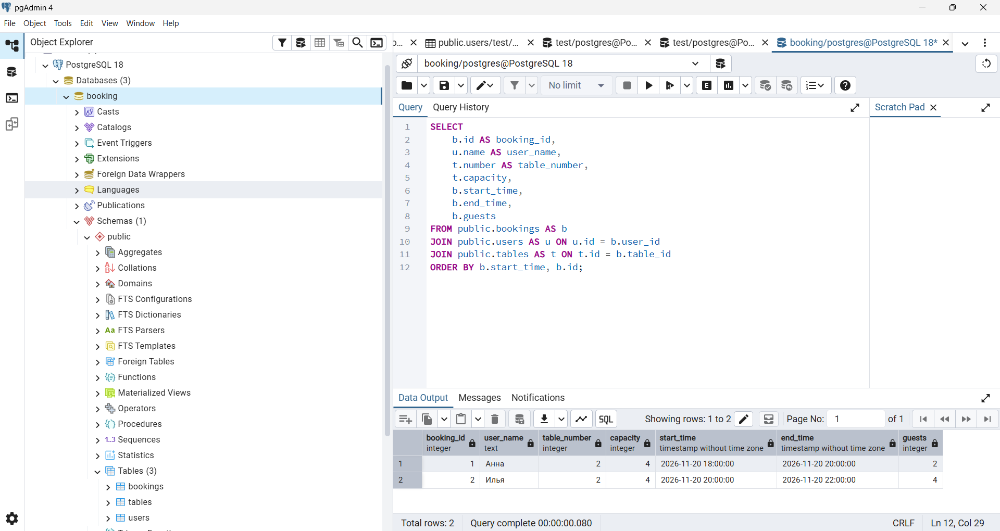
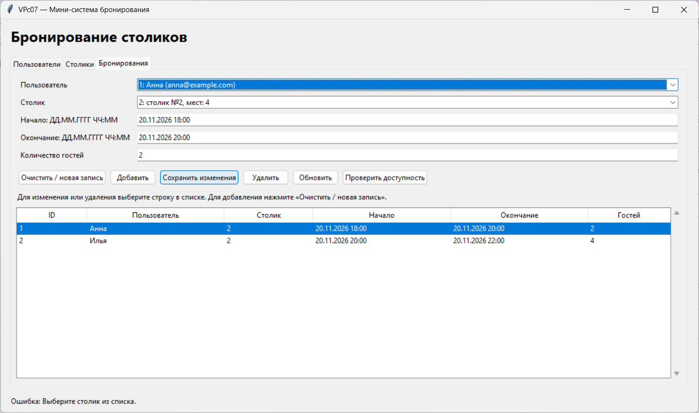
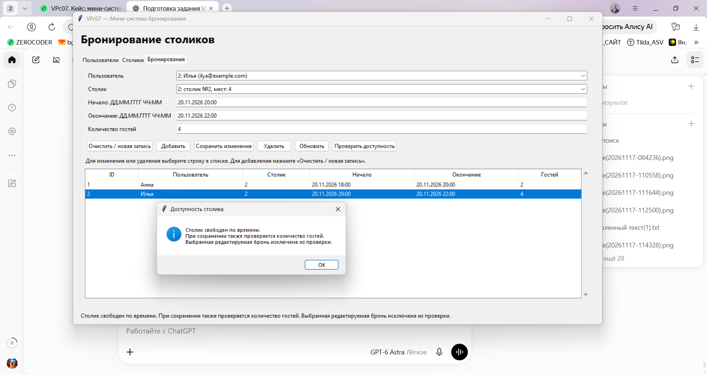

# VPc07 — Мини-система бронирования столиков

Автор: Патраков Владислав Валерьевич.

Учебное приложение на Python с графическим интерфейсом Tkinter
и хранением данных в PostgreSQL.

## Возможности

- Добавление, просмотр, изменение и удаление пользователей.
- Добавление, просмотр, изменение и удаление столиков.
- Создание, просмотр, изменение и удаление бронирований.
- Проверка доступности столика на выбранный период.
- Запрет пересекающихся бронирований одного столика.
- Проверка количества гостей относительно вместимости столика.
- Проверка корректности начала и окончания бронирования.
- Запрет удаления пользователя или столика со связанными бронированиями.
- Запрет уменьшения вместимости ниже количества гостей существующей брони.

Соседние интервалы разрешены: например, 18:00–20:00 и 20:00–22:00.

## Технологии

- Python 3.12.
- PostgreSQL 18.
- psycopg2-binary.
- python-dotenv.
- Tkinter.

## Основные файлы

- `app.py` — графический интерфейс.
- `backend.py` — логика приложения и операции с данными.
- `postgres_driver.py` — подключение, транзакции и создание таблиц.
- `models/` — модели пользователя, столика и бронирования.
- `init_db.py` — создание таблиц.
- `seed_data.py` — добавление начальных пользователей и столиков.
- `demo_bookings.py` — демонстрационные бронирования.
- `check_connection.py` — проверка подключения.
- `check_models.py` — проверка моделей.
- `check_crud.py` — проверка операций и ограничений.
- `requirements.txt` — зависимости.
- `.env.example` — пример настроек подключения.
- `screenshots/` — скриншоты работы приложения.

## Подготовка

Команды выполняются в PowerShell из папки проекта.

1. Установите Python и PostgreSQL.
2. Создайте в pgAdmin базу данных `booking`.
3. Создайте виртуальное окружение:

```powershell
py -m venv .venv
```

4. Установите зависимости:

```powershell
.\.venv\Scripts\python.exe -m pip install -r .\requirements.txt
```

5. Скопируйте `.env.example` в `.env`:

```powershell
Copy-Item .\.env.example .\.env
```

Если `.env` уже настроен, повторно копировать файл не нужно.

6. В `.env` укажите параметры своего сервера:
`DB_HOST`, `DB_PORT`, `DB_NAME`, `DB_USER`, `DB_PASSWORD`.

Для этой работы используется `DB_NAME=booking`.
Настоящий пароль хранится только в локальном `.env`.

## Создание таблиц и демонстрационных данных

Выполните последовательно:

```powershell
.\.venv\Scripts\python.exe .\check_connection.py
.\.venv\Scripts\python.exe .\init_db.py
.\.venv\Scripts\python.exe .\seed_data.py
.\.venv\Scripts\python.exe .\demo_bookings.py
```

После подготовки в базе находятся:
- 3 пользователя;
- 3 столика;
- 2 бронирования.

Повторный запуск заполнения на подготовленной базе
не добавляет дубликаты демонстрационных записей.

## Запуск приложения

```powershell
.\.venv\Scripts\python.exe .\app.py
```

В приложении доступны вкладки:
«Пользователи», «Столики», «Бронирования».

Для добавления нажмите «Очистить / новая запись», заполните поля
и нажмите «Добавить».

Для изменения выберите запись, исправьте поля
и нажмите «Сохранить изменения».

Для проверки свободного времени выберите столик,
укажите начало и окончание и нажмите «Проверить доступность».

При проверке выбранной редактируемой брони
сама эта бронь исключается из поиска пересечений.
Вместимость дополнительно проверяется при сохранении.

## Проверки

```powershell
.\.venv\Scripts\python.exe .\check_models.py
.\.venv\Scripts\python.exe .\check_crud.py
```

Проверены создание, чтение, изменение и удаление записей,
ограничения вместимости, пересечения интервалов
и запрет удаления связанных записей.

Результат: «ВСЕ ПРОВЕРКИ ПРОЙДЕНЫ».
Тестовые записи удалены. Итоговые количества: `(3, 3, 2)`.

Через интерфейс также проверены добавление временной брони,
изменение количества гостей и удаление этой брони.

## Пример проверки доступности

Для столика №2 на 20.11.2026:
- 19:00–21:00 — занят;
- 22:00–23:00 — свободен.

## Скриншоты

### Таблицы базы данных



### Список бронирований



### Проверка доступности в приложении



## Конфиденциальные данные

Файл `.env` с настоящим паролем не включён в репозиторий.
Для настройки подключения предоставлен `.env.example`.